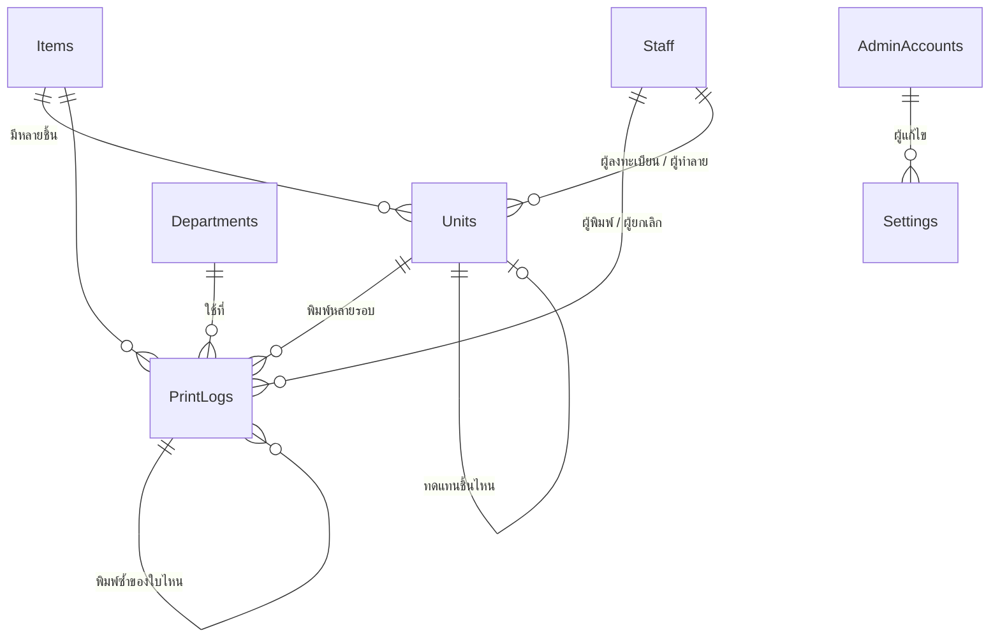

# ฐานข้อมูล Single-Use Sticker (Microsoft SQL Server)

ฐานข้อมูลใหม่ชื่อ **`SingleUseSticker`** แยกจากฐานข้อมูลเดิมบนเซิร์ฟเวอร์ทั้งหมด
โปรแกรมเข้าถึงด้วย login **`singleuse_app`** ที่มีสิทธิ์เฉพาะฐานข้อมูลนี้ — ไม่แตะข้อมูลของระบบอื่น

- รองรับ SQL Server **2016 ขึ้นไป** (รวม Express)
- Collation `Thai_CI_AS` — เรียงภาษาไทยถูกต้อง, SN ไม่สนตัวพิมพ์เล็ก/ใหญ่

## ขั้นตอนติดตั้ง (ฝ่าย IT ทำผ่าน SSMS)

| ลำดับ | ไฟล์ | ผู้รัน | ทำอะไร |
|---|---|---|---|
| 0 | `00_create_database.sql` | sysadmin | สร้างฐานข้อมูล + login `singleuse_app` (แก้รหัสผ่านในไฟล์ก่อนรัน) |
| 1 | `01_schema_v1.sql` | sysadmin หรือ `singleuse_app` | สร้างตาราง ดัชนี view และบัญชีแอดมินเริ่มต้น |
| 2 | `02_departments.sql` | sysadmin หรือ `singleuse_app` | เพิ่มตารางหน่วยงาน + "ใช้ที่" ในประวัติการพิมพ์ |

1. เปิด SSMS → เชื่อมต่อเซิร์ฟเวอร์ด้วยบัญชีผู้ดูแล
2. File → Open → `00_create_database.sql` → แก้ `@AppPassword` → Execute (F5)
3. File → Open → `01_schema_v1.sql` → Execute (F5) แล้วรัน `02_departments.sql` ต่อตามลำดับ
4. ตรวจสอบ: `SELECT * FROM SingleUseSticker.dbo.SchemaVersion` ต้องเห็นเวอร์ชัน 1 และ 2
5. ส่งข้อมูลนี้ให้ผู้ติดตั้งโปรแกรม: ชื่อ/IP เซิร์ฟเวอร์, พอร์ต (ปกติ 1433), รหัสผ่านของ `singleuse_app`

ถ้าเกิดข้อผิดพลาดระหว่างรัน `01_schema_v1.sql` สคริปต์จะยกเลิกทั้งหมด (ไม่เหลือตารางครึ่ง ๆ กลาง ๆ) แก้แล้วรันใหม่ได้
และรันซ้ำได้ — ถ้าติดตั้งเวอร์ชันนั้นไปแล้วจะไม่ทำอะไรซ้ำ

> **ต้องเปลี่ยนรหัสผ่านแอดมินเริ่มต้น** (`admin` / `admin1234`) ที่เมนูบัญชีแอดมินหลังติดตั้ง
> และเพิ่มฐานข้อมูล `SingleUseSticker` เข้าแผนสำรองข้อมูล (backup) ของเซิร์ฟเวอร์

## โครงสร้างตาราง



| ตาราง | 1 แถว = | หมายเหตุ |
|---|---|---|
| `Items` | รายการอุปกรณ์ 1 รายการ (เช่น สาย Suction) | อายุหลัง sterilize, รอบสูงสุด, คำนำหน้า SN, ชนิดรหัสเริ่มต้น (บาร์โคด/QR/ไม่มี) · ปิดใช้งานแทนการลบ |
| `Staff` | เจ้าหน้าที่ 1 คน | ชื่อ (ห้ามซ้ำ), รหัสพนักงาน · ปิดใช้งานแทนการลบ |
| `Departments` | หน่วยงานที่นำไปใช้ 1 หน่วย (เช่น ห้องผ่าตัด) | ชื่อ (ห้ามซ้ำ), รหัส/ชื่อย่อ · ปิดใช้งานแทนการลบ · เพิ่มในเวอร์ชัน 2 |
| `Units` | อุปกรณ์ 1 ชิ้น (1 SN) | SN ห้ามซ้ำทั้งระบบ, รอบสูงสุด ณ วันลงทะเบียน, ทดแทนชิ้นไหน, ข้อมูลการทำลาย |
| `PrintLogs` | สติ๊กเกอร์ 1 ดวง | รอบ, วันผลิต/หมดอายุ, ชนิดรหัส, ซ่อนวันที่, ผู้พิมพ์, หน่วยงานที่ใช้ (ไม่บังคับ), พิมพ์ซ้ำ, ข้ามรอบ, การยกเลิก |
| `AdminAccounts` | บัญชีแอดมิน 1 บัญชี | รหัสผ่านเก็บเป็น hash (PBKDF2-SHA256 + salt) |
| `Settings` | ค่าตั้งค่า 1 ค่า | key/value เช่น `brand.hospitalName`, `brand.hospitalLogo` |
| `AuditLog` | การแก้ไข 1 ครั้ง | ใครแก้อะไรเมื่อไร (รายการอุปกรณ์, เจ้าหน้าที่, ตั้งค่า, ทำลาย) |
| `SchemaVersion` | สคริปต์ที่รันแล้ว 1 ไฟล์ | ใช้ตรวจว่าฐานข้อมูลอยู่เวอร์ชันไหน |

### กติกาที่ฐานข้อมูลบังคับเอง (กันข้อมูลผิดแม้โปรแกรมมีบั๊ก)

- SN ห้ามซ้ำ, ห้ามมีช่องว่าง
- รอบที่พิมพ์ต้องอยู่ระหว่าง 1 ถึงรอบสูงสุด และวันหมดอายุต้องไม่ก่อนวันผลิต
- **1 ชิ้น 1 รอบ มีใบปกติที่ยังมีผลได้ใบเดียว** — ถ้า 2 เครื่องยิง SN เดียวกันพร้อมกัน เครื่องที่สองจะถูกปฏิเสธ
- พิมพ์ข้ามรอบต้องมีหมายเหตุ / ยกเลิกใบต้องมีเหตุผล / ทำลายก่อนครบรอบต้องมีรายละเอียด
- พิมพ์ซ้ำต้องอ้างใบต้นฉบับ

### รอบที่ใช้ไปของแต่ละชิ้น

= รอบสูงสุดของใบปกติที่ยังไม่ถูกยกเลิก (`PrintLogs` ที่ `IsReprint = 0` และ `VoidedAt IS NULL`)
ดูสถานะทุกชิ้นได้ทันทีจาก view **`dbo.vw_UnitStatus`** — `new` ชิ้นใหม่ / `active` ใช้งานได้ / `last` ครบรอบรอทำลาย / `disposed` ทำลายแล้ว

```sql
-- ตัวอย่าง: ชิ้นที่ครบรอบรอทำลาย
SELECT Sn, ItemName, UsedRounds, MaxRound, LastPrintedAt
FROM SingleUseSticker.dbo.vw_UnitStatus
WHERE Status = 'last'
ORDER BY ItemName, Sn;
```

## ค่าที่ไม่เก็บในฐานข้อมูล

- **ตั้งค่าเครื่องพิมพ์** (ชื่อเครื่อง, เลื่อนตำแหน่ง X/Y) — เป็นค่าของแต่ละเครื่องหน้างาน เก็บในเบราว์เซอร์เครื่องนั้นเหมือนเดิม
- **เจ้าหน้าที่ที่เลือกไว้ในหน้าพิมพ์** — เลือกใหม่ทุกครั้งที่เปิดโปรแกรม

## การแก้ไขโครงสร้างในอนาคต

ทำได้โดยไม่ต้องลบข้อมูลเดิม:

1. เพิ่มไฟล์ใหม่ตามลำดับ เช่น `02_add_department.sql`, `03_...` — **ห้ามแก้ไฟล์ที่รันไปแล้ว**
2. ในไฟล์ใหม่ เช็ค `SchemaVersion` ก่อน (ถ้ารันแล้วไม่ทำซ้ำ) แล้วจบด้วย `INSERT INTO dbo.SchemaVersion (Version, Description) VALUES (2, N'...')`
3. ใช้คำสั่งที่ไม่ทำลายข้อมูล เช่น `ALTER TABLE ... ADD` คอลัมน์ใหม่ (อนุญาต NULL หรือมีค่าเริ่มต้น), สร้างตารางใหม่
4. สำรองฐานข้อมูลก่อนรันทุกครั้ง แล้วรันใน SSMS เหมือนขั้นตอนติดตั้ง

## ตรงกับข้อมูลในโปรแกรม

| ในโปรแกรม (TypeScript) | ในฐานข้อมูล |
|---|---|
| `MasterItem` (`shelf`, `maxRound`, `useBarcode`, `snPrefix`) | `Items` (`ShelfDays`, `MaxRound`, `DefaultCodeType`, `SnPrefix`) |
| `Unit` (`sn`, `replacesSn`, `disposedAt`, `disposeReason`, `disposeNote`) | `Units` (`Sn`, `ReplacesUnitId`, `DisposedAt`, `DisposeReason`, `DisposeNote`) |
| `PrintLog` (`barcode`, `name`, `mfg`, `exp`, `codeType`, `showMfg`, `showExp`, `sourceId`, `voided*`) | `PrintLogs` (`Sn`, `ItemName`, `MfgDate`, `ExpDate`, `CodeType`, `ShowMfg`, `ShowExp`, `SourcePrintLogId`, `Void*`) |
| `Staff` | `Staff` |
| `Department` (`departmentId`, `departmentName`, `showDept` ใน `PrintLog`) | `Departments`, `PrintLogs` (`DepartmentId`, `DepartmentName`, `ShowDept`) |
| บัญชีแอดมิน (`sticker_admins`) | `AdminAccounts` |
| โลโก้/ชื่อ (`sticker_brand`) | `Settings` (`brand.*`) |
